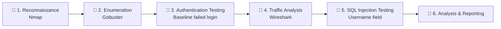

<div align="center">

# 🛡️ Web Application Penetration Testing Report

### 🦊 ShadowFox Cybersecurity Internship · November 2026 Batch


**👤 Prepared by Lucky Samuel**

</div>

> [!WARNING]
> **⚠️ Ethical use only.** All testing was performed against a deliberately vulnerable demonstration website provided for training. Never run these techniques against systems you do not own or have written permission to test.

---

## 📑 Table of Contents

- [📖 1. Introduction](#-1-introduction)
- [📋 2. Information About the Report and the Machine](#-2-information-about-the-report-and-the-machine)
- [🎯 3. Attack Vector Plans and Initiated Attacks](#-3-attack-vector-plans-and-initiated-attacks)
  - [🔍 3.1 Port Scanning and Service Enumeration](#-31-port-scanning-and-service-enumeration)
  - [📂 3.2 Directory Enumeration](#-32-directory-enumeration)
  - [🔑 3.3 Initial Login Attempt Using Incorrect Credentials](#-33-initial-login-attempt-using-incorrect-credentials)
  - [📡 3.4 Network Traffic Analysis Using Wireshark](#-34-network-traffic-analysis-using-wireshark)
  - [💉 3.5 SQL Injection: Authentication Bypass](#-35-sql-injection-authentication-bypass)
  - [🔒 3.6 HTTP Security Observations](#-36-http-security-observations)
- [📊 4. Summary of Findings and Risk Assessment](#-4-summary-of-findings-and-risk-assessment)
- [🏁 5. Conclusion](#-5-conclusion)
- [🧰 6. Resources Used](#-6-resources-used)

<details>
<summary>🖼️ <b>List of Figures</b></summary>

<br>

| Figure | Name |
|:---:|---|
| 1 | Nmap full TCP port scan |
| 2 | Nmap service detection results |
| 3 | Gobuster directory enumeration results |
| 4 | Initial login attempt showing invalid credentials |
| 5 | Wireshark capture of the initial login request |
| 6 | Baseline failed login response |
| 7 | SQL injection request captured in Wireshark |
| 8 | HTTP 302 redirect following the SQL injection attempt |
| 9 | Resulting forum page displaying the logout option |

</details>

### 🚦 Severity Legend

| Icon | Level |
|:---:|---|
| 🔴 | High |
| 🟠 | Medium |
| 🟡 | Low |
| 🔵 | Informational |

---

## 📖 1. Introduction

Web applications are commonly exposed to security risks arising from weaknesses in authentication mechanisms, input validation, server configurations, and communication protocols. These weaknesses can potentially allow attackers to access restricted resources, manipulate application behaviour, or obtain sensitive information.

As part of my cybersecurity training with **ShadowFox**, I conducted a practical web application penetration test against the assigned demonstration website, <http://testasp.vulnweb.com/>.

The assessment involved:

- 🌐 identifying exposed network services
- 📂 discovering accessible directories
- 🔑 examining the website's login functionality
- 📡 analyzing network traffic generated during authentication

Particular attention was given to testing the login mechanism for **SQL injection** vulnerabilities. A normal login attempt using incorrect credentials was first performed to establish a baseline response. This was followed by a controlled SQL injection test to determine whether specially crafted input could alter the application's authentication behaviour.

> [!NOTE]
> 🎓 The purpose of this assessment was to identify potential security weaknesses, understand their impact, document the evidence obtained, and recommend appropriate remediation measures.

---

## 📋 2. Information About the Report and the Machine

### 🧾 2.1 Report Information

| Parameter | Details |
|---|---|
| 📌 Report Title | Web Application Penetration Testing Report – Task 1 and 3 |
| 👤 Prepared By | Lucky Samuel |
| 🏫 Institution | ShadowFox |
| 📅 Batch | November batch |
| 🗂️ Report Type | Web Application Penetration Testing and Security Assessment |

### 🎯 2.2 Target Machine / Website Information

| Parameter | Details |
|---|---|
| 🌍 Target Website | `testasp.vulnweb.com` |
| 🔗 Target URL | `http://testasp.vulnweb.com/` |
| 🧭 Target IP Address | `44.238.29.244` |
| 🐉 Operating System Used for Testing | Kali Linux |
| 🖥️ Identified Web Server | Microsoft IIS 8.5 |
| 🔓 Primary Web Protocol | HTTP |
| 🦊 Browser | Firefox |
| 🔍 Port Scanning Tool | Nmap |
| 📂 Directory Enumeration Tool | Gobuster |
| 📡 Traffic Analysis Tool | Wireshark |

### 🧪 2.3 Scope of Assessment

**✅ In scope**

- 🌐 Network reconnaissance and port scanning
- 🔎 Service identification and enumeration
- 📂 Directory and file discovery
- 🔑 Login functionality testing
- 💉 SQL injection testing
- 📡 HTTP traffic inspection
- 🕵️ Identification of potential security weaknesses
- 🛠️ Security recommendations and remediation

**🚫 Out of scope**

- 💣 Destructive testing
- 🌊 Denial-of-service attacks
- 🗄️ Database extraction

### 🏹 2.4 Assessment Objectives

1. 🔍 Identify open ports and services accessible on the target.
2. 📂 Discover directories and publicly accessible resources.
3. 🔑 Examine the website's authentication process.
4. ❌ Determine whether incorrect credentials were properly rejected.
5. 💉 Investigate whether SQL injection could affect the login process.
6. 📡 Inspect authentication traffic to determine whether sensitive information was transmitted securely.
7. 📝 Document findings and recommend suitable security improvements.

### 🗺️ 2.5 Planning and Testing Methodology

The assessment followed a structured penetration testing methodology to ensure that the target was examined systematically.



| Stage | Name | Description |
|:---:|---|---|
| 1️⃣ | 🔭 **Reconnaissance** | The target domain was identified and its IP address resolved. Nmap was used to identify open TCP ports and gather information about exposed services. |
| 2️⃣ | 📂 **Enumeration** | Gobuster was used to identify directories and files available on the website. Discovered paths were reviewed to understand the publicly accessible structure of the application. |
| 3️⃣ | 🔑 **Authentication Testing** | The login functionality was examined using incorrect test credentials to establish a baseline server response. |
| 4️⃣ | 📡 **Traffic Analysis** | Wireshark was used to capture and inspect the HTTP requests and responses generated during authentication. |
| 5️⃣ | 💉 **SQL Injection Testing** | A controlled SQL injection payload was entered into the username field to examine whether the authentication mechanism could be bypassed. |
| 6️⃣ | 📝 **Analysis and Reporting** | Results were analyzed, potential security implications identified, and recommendations developed. |

---

## 🎯 3. Attack Vector Plans and Initiated Attacks

The following tests were conducted against the assigned demonstration website. Severity levels are retained from the assessment.

---

### 🔍 3.1 Port Scanning and Service Enumeration

| Required Item | Details |
|---|---|
| **Attack Name** | Network Port Scanning |
| **Severity Level** | 🔵 Informational |
| **Tool Used** | 🔍 Nmap |

#### 🪜 Steps

**📍 Step 1: Target Identification**

The target domain `testasp.vulnweb.com` resolved to the IP address `44.238.29.244`.

**🌐 Step 2: Full TCP Port Scan**

```bash
nmap -Pn -p- testasp.vulnweb.com
```

The scan identified two open TCP ports:

| Port | State | Service |
|:---:|:---:|---|
| 80/tcp | 🟢 Open | HTTP |
| 587/tcp | 🟢 Open | Submission |

The remaining **65,533** TCP ports were reported as filtered. This indicates that the target responded on ports 80 and 587, while the other scanned ports did not respond to the probes.

**🔎 Step 3: Service Version Detection**

```bash
nmap -sV -sC -Pn -p 80,587 testasp.vulnweb.com
```

| Port | Service Information |
|:---:|---|
| 80/tcp | Microsoft IIS HTTP server, version 8.5 |
| 587/tcp | Open, identified as `tcpwrapped` |

Additional observations:

- 🖥️ The HTTP response identified `Microsoft-IIS/8.5`.
- 🏷️ The website title was identified as *acuforum forums*.
- ⚠️ The HTTP TRACE method was reported as potentially risky.
- 🍪 The ASP session cookie was reported without the `HttpOnly` flag.
- ❓ Nmap could not establish a connection to identify the service on port 587.

#### 💥 Impact

- Port scanning provided information about the target's exposed services and web server technology.
- The HTTP service was accessible over port 80, meaning communication with the website used an unencrypted HTTP connection.
- The missing `HttpOnly` flag on the ASP session cookie may increase the risk of session-cookie theft if a cross-site scripting vulnerability is present.
- The presence of the TRACE method requires review because it can introduce security concerns depending on server configuration and surrounding application controls.

> [!NOTE]
> An open port or an identified server version does not automatically establish that the service is vulnerable.

<details>
<summary>🛠️ <b>Mitigation Steps</b></summary>

<br>

1. Disable unnecessary network services and close unused ports.
2. Restrict access to administrative and non-public services.
3. Use HTTPS to protect communication between users and the web application.
4. Review and disable HTTP methods that are not required, including TRACE where appropriate.
5. Configure session cookies with `HttpOnly`, `Secure`, and `SameSite` attributes.
6. Keep the web server updated with supported security patches.
7. Review firewall rules to ensure only required services are accessible.

</details>

#### 📸 Screenshots

<p align="center">
   
  <em>Figures 1 & 2: Nmap full TCP port scan and service detection</em>
</p>

---

### 📂 3.2 Directory Enumeration

| Required Item | Details |
|---|---|
| **Attack Name** | Web Directory Enumeration |
| **Severity Level** | 🔵 Informational |
| **Tool Used** | 📂 Gobuster |

#### 🪜 Steps

**📂 Step 1: Directory Enumeration**

Gobuster was used with a common directory wordlist to discover accessible directories and files:

```bash
gobuster dir -u http://testasp.vulnweb.com/ -w /usr/share/wordlists/dirb/common.txt -t 5
```

| Discovered Path | HTTP Status | Observation |
|---|:---:|---|
| `_vti_cnf` | 301 | ↪️ Redirect |
| `aspnet_client` | 301 | ↪️ Redirect |
| `avatars` | 301 | ↪️ Redirect |
| `cgi-bin` | 301 | ↪️ Redirect |
| `cgi-bin/` | 403 | 🚫 Forbidden |
| `html` | 301 | ↪️ Redirect |
| `HTML` | 301 | ↪️ Redirect |
| `Images` | 301 | ↪️ Redirect |
| `images` | 301 | ↪️ Redirect |
| `jscripts` | 301 | ↪️ Redirect |
| `robots.txt` | 200 | ✅ Accessible |
| `t` | 301 | ↪️ Redirect |
| `T` | 301 | ↪️ Redirect |
| `templates` | 301 | ↪️ Redirect |

Most discovered directories returned HTTP 301, indicating that the server redirected requests to their trailing-slash versions. The `cgi-bin/` path returned HTTP 403 Forbidden, indicating that access was denied. The `robots.txt` file returned HTTP 200, indicating that it was accessible.

**🤖 Step 2: Inspecting `robots.txt`**

```bash
curl http://testasp.vulnweb.com/robots.txt
```

Response:

```text
User-agent: *
```

The file contained a general user-agent declaration but did not specify any `Disallow` directives, meaning it did not list particular paths that crawlers were instructed to avoid.

> [!IMPORTANT]
> A `robots.txt` file does not provide access control or prevent unauthorized users from accessing website resources.

#### 💥 Impact

Directory enumeration revealed several paths associated with the website's structure. Although the scan did not establish that these directories contained sensitive information, publicly reachable paths can provide useful information to an attacker during reconnaissance. The `cgi-bin/` 403 response also demonstrated that the server restricted access to that particular path.

<details>
<summary>🛠️ <b>Mitigation Steps</b></summary>

<br>

1. Remove unnecessary directories and files from the web root.
2. Restrict access to sensitive or administrative directories.
3. Disable directory listing where it is not required.
4. Ensure that configuration and backup files are not publicly accessible.
5. Review legacy directories and remove unused components.
6. Do not rely on `robots.txt` to protect sensitive resources.
7. Apply appropriate server-side access controls.

</details>

#### 📸 Screenshot

<p align="center">
  
  <em>Figure 3: Completed Gobuster scan</em>
</p>

---

### 🔑 3.3 Initial Login Attempt Using Incorrect Credentials

| Required Item | Details |
|---|---|
| **Attack Name** | Authentication Testing – Baseline Failed Login |
| **Severity Level** | 🔵 Informational |
| **Tools Used** | 🦊 Firefox Browser and 📡 Wireshark |

#### 🪜 Steps

**🌐 Step 1: Accessing the Login Page**

The target website was opened in Firefox at `http://testasp.vulnweb.com/` and the login page was accessed.

**❌ Step 2: Submitting Incorrect Test Credentials**

A normal login attempt was performed using the username `admin` and an incorrect test password. The server processed the request and returned:

```http
HTTP/1.1 200 OK
```

The response body contained:

```html
<b>Invalid login!</b>
```

This indicated that the application rejected the supplied credentials.

> [!NOTE]
> HTTP `200 OK` only indicates that the server successfully processed the HTTP request. It does **not** mean authentication was successful. The application therefore provided a clear baseline response for an ordinary failed login attempt.

#### 💥 Impact

The normal login attempt did not demonstrate an authentication bypass. However, the request was submitted over HTTP rather than HTTPS. This raised a separate security concern because information transmitted through HTTP is not encrypted and may be visible to anyone able to intercept the traffic.

<details>
<summary>🛠️ <b>Mitigation Steps</b></summary>

<br>

1. Enforce HTTPS for all login and authentication pages.
2. Redirect HTTP requests to HTTPS.
3. Use secure session management.
4. Apply appropriate login rate limiting.
5. Monitor repeated failed login attempts.
6. Avoid transmitting authentication information through unencrypted connections.

</details>

#### 📸 Screenshots

<p align="center">
 
  


  <em>Figures 4 & 6: Initial login attempt and baseline failed login response</em>
</p>

---

### 📡 3.4 Network Traffic Analysis Using Wireshark

| Required Item | Details |
|---|---|
| **Attack Name** | HTTP Traffic Inspection / Credential Exposure |
| **Severity Level** | 🔴 High |
| **Tool Used** | 📡 Wireshark |

#### 🪜 Steps

**▶️ Step 1: Start Packet Capture**

Wireshark was opened and the `eth0` interface was selected. Packet capture was started before submitting the login form.

**🧹 Step 2: Filter HTTP Traffic**

Display filter used:

```text
http
```

This isolated the HTTP requests and responses generated during the login process.

**🔬 Step 3: Inspect the Login Request**

The captured traffic showed a POST request:

```http
POST /Login.asp?RetURL=%2FDefault%2Easp%3F HTTP/1.1
Host: testasp.vulnweb.com
Content-Type: application/x-www-form-urlencoded
```

The submitted form data contained the username and test password.

> [!NOTE]
> 🔐 For security and reporting purposes, the actual password is not reproduced here.

The server also returned the invalid-login response observed in the browser, confirming the capture corresponded to the ordinary failed login attempt.

#### 💥 Impact

The transmission of authentication information over HTTP creates a risk of credential exposure. An attacker capable of intercepting the traffic may be able to read the submitted form data, which could lead to unauthorized account access if the exposed credentials are reused or otherwise remain valid.

<details>
<summary>🛠️ <b>Mitigation Steps</b></summary>

<br>

1. Implement HTTPS across the entire website.
2. Redirect all HTTP traffic to HTTPS.
3. Configure HTTP Strict Transport Security (HSTS).
4. Set the `Secure` attribute on session cookies.
5. Set the `HttpOnly` attribute on session cookies.
6. Configure the `SameSite` attribute appropriately.
7. Avoid transmitting passwords or session information through unencrypted connections.

</details>

#### 📸 Screenshot

<p align="center">


  <em>Figure 5: Wireshark capture of the initial login request</em>
</p>

---

### 💉 3.5 SQL Injection: Authentication Bypass

| Required Item | Details |
|---|---|
| **Attack Name** | SQL Injection Authentication Bypass |
| **Affected Endpoint** | `/Login.asp` |
| **Affected Parameter** | `tfUName` |
| **Severity Level** | 🔴 High (Provisional) |

#### 🪜 Steps

**📏 Step 1: Establishing the Normal Login Response**

Before testing SQL injection, an ordinary login attempt with an incorrect test password returned `HTTP/1.1 200 OK` with `<b>Invalid login!</b>` in the body. This confirmed the application rejected ordinary incorrect credentials.

**🧪 Step 2: Preparing the SQL Injection Payload**

The following payload was entered into the username field:

```sql
' OR '1'='1'--
```

Its purpose was to test whether user input could alter the logic of the application's authentication query.

| Component | Purpose |
|:---:|---|
| `'` | Attempts to close an existing quoted string |
| `OR '1'='1'` | Introduces a condition that evaluates to true |
| `--` | Attempts to comment out the remainder of the SQL statement (depending on database syntax) |

**📤 Step 3: Submitting the SQL Injection Payload**

The payload was entered into the username field, the form was submitted, and the request was captured in Wireshark:

```http
POST /Login.asp?RetURL=%2FDefault%2Easp%3F HTTP/1.1
Host: testasp.vulnweb.com
Content-Type: application/x-www-form-urlencoded
```

Encoded username parameter:

```text
tfUName=Admin%27+OR+%271%27%3D%271%27--
```

Decoded value:

```text
Admin' OR '1'='1'--
```

**📥 Step 4: Examining the Server Response**

```http
HTTP/1.1 302 Object moved
Location: /Default.asp?
```

This differed from the earlier normal login attempt, which returned HTTP 200 OK with an invalid-login message. The browser then followed the redirect:

```http
GET /Default.asp? HTTP/1.1
```

The resulting page returned `HTTP/1.1 200 OK`.

**💬 Step 5: Examining the Resulting Forum Page**

After the redirect, the browser displayed the forum page, which contained a logout link with the injected username reflected in it:

```html
<a href="./Logout.asp?RetURL=%2FDefault%2Easp%3F" class="menu">
logout Admin' OR '1'='1'--
</a>
```

The presence of the logout option and the change in server response were significant observations.

#### 🔬 Analysis of Results

| Test | Input | Server Response | Observation |
|---|---|:---:|---|
| ❌ Normal login attempt | Ordinary username and incorrect test password | `200 OK` | Application displayed *Invalid login!* |
| 💉 SQL injection attempt | `Admin' OR '1'='1'--` in username field | `302 Object moved` | Browser redirected to `/Default.asp?` |
| ➡️ Following redirect | Browser requested `/Default.asp?` | `200 OK` | Forum page loaded and displayed a logout link containing the injected username |

The normal login attempt was rejected. After the SQL injection payload was submitted, however, the application returned a redirect to the forum page instead of the invalid-login response, and the resulting page displayed a logout link containing the injected username. These observations provide evidence **consistent with** an SQL injection authentication bypass.

> [!CAUTION]
> The exact database query and database engine were not directly observed during the assessment. This report therefore does not claim to know the precise SQL statement executed by the application.

#### 💥 Impact

If the authentication bypass is confirmed, an attacker may be able to access application functionality without providing valid login credentials. Potential consequences include:

1. 👤 Unauthorized access to user accounts or restricted application features.
2. 🚪 Circumvention of authentication controls.
3. 👁️ Exposure of information available to authenticated users.
4. ✏️ Potential manipulation of application data, depending on database permissions and other security controls.
5. 🔗 Further exploitation if additional database weaknesses exist.

The actual impact depends on the privileges available to the affected application account and the database configuration.

<details>
<summary>🛠️ <b>Mitigation Steps</b></summary>

<br>

1. Use parameterized queries or prepared statements for all database operations.
2. Never construct SQL queries by directly concatenating user-supplied input.
3. Apply server-side input validation.
4. Use least-privilege database accounts.
5. Avoid revealing detailed database errors to users.
6. Implement secure authentication and session management.
7. Perform security testing on all login-related parameters.
8. Encode user-controlled values before displaying them in HTML.
9. Review application code for other SQL injection weaknesses.
10. Use a supported web application framework with secure database access methods.

</details>

#### 📸 Screenshots

<p align="center">
  

  <em>Figure 7: SQL injection request captured in Wireshark</em>
</p>


---

### 🔒 3.6 HTTP Security Observations

| Required Item | Details |
|---|---|
| **Attack Name** | HTTP Security Configuration Review |
| **Severity Level** | Observations identified; no separate overall rating assigned |
| **Severity Score** | Not calculated in the supplied assessment |

During the assessment, the web server was observed using HTTP, and Nmap identified additional security configuration concerns. These were documented because insecure communication and cookie settings can increase the risk of account compromise.

#### 🔎 Findings

**1️⃣ 🔓 Unencrypted HTTP Communication**

The website was accessed through `http://testasp.vulnweb.com/`, and Wireshark captured the login POST request showing authentication form data transmitted over HTTP.

- 💥 **Impact:** Credentials and other sensitive information may be exposed to attackers capable of monitoring the communication path.
- 🛠️ **Mitigation:** Enforce HTTPS, redirect HTTP requests to HTTPS, and configure HSTS.

**2️⃣ 🍪 Missing HttpOnly Cookie Attribute**

Nmap reported that the ASP session cookie did not have the `HttpOnly` flag set.

- 💥 **Impact:** If a cross-site scripting vulnerability exists, malicious JavaScript may be able to access the session cookie.
- 🛠️ **Mitigation:** Configure session cookies with `HttpOnly`, alongside `Secure` and appropriate `SameSite` settings.

**3️⃣ 🔍 HTTP TRACE Method**

Nmap identified TRACE as a potentially risky HTTP method.

- 💥 **Impact:** TRACE may create unnecessary exposure depending on the server configuration and application environment.
- 🛠️ **Mitigation:** Disable TRACE if it is not required and review the server's permitted HTTP methods.

#### 🧭 Overall Assessment

These observations indicate areas where the server and application security configuration should be reviewed.

> [!NOTE]
> The presence of a security-related configuration issue does not automatically establish that it can be exploited. Further validation is required to determine the exact risk in the target environment.

---

## 📊 4. Summary of Findings and Risk Assessment

| S/N | Finding | Severity | Evidence |
|:---:|---|:---:|---|
| 1 | Open TCP ports 80 and 587 | 🔵 Informational | Nmap scan |
| 2 | Publicly discoverable directories | 🔵 Informational | Gobuster results |
| 3 | Authentication information transmitted over HTTP | 🔴 **High** | Wireshark capture |
| 4 | SQL injection authentication bypass | 🔴 **High (provisional)** | Login response comparison and redirect |
| 5 | ASP session cookie missing `HttpOnly` flag | 🟠 Medium | Nmap script output |
| 6 | HTTP TRACE method enabled | 🟡 Low to 🟠 Medium | Nmap script output |

### 🏆 4.1 Most Significant Finding

The most significant finding was the **SQL injection behaviour** observed during the authentication test. The initial login attempt using incorrect credentials returned an invalid-login message. However, the subsequent SQL injection test produced an HTTP 302 redirect to the forum page, followed by a successful page load. This difference suggests that the application's authentication mechanism may be vulnerable to SQL injection.

### 🚀 4.2 Recommended Priorities

| Priority | Action | Details |
|:---:|---|---|
| 🥇 **1** | 💉 **Fix the SQL injection vulnerability** | Review the authentication code and replace dynamically constructed SQL statements with parameterized queries. |
| 🥈 **2** | 🔐 **Enforce HTTPS** | Protect login information and session data by encrypting communication between users and the website. |
| 🥉 **3** | 🍪 **Improve session cookie security** | Configure session cookies with `HttpOnly`, `Secure`, and `SameSite` attributes. |
| 4️⃣ | ⚙️ **Review web server configuration** | Disable unnecessary HTTP methods and review exposed services. |
| 5️⃣ | 📂 **Review directory access** | Ensure that sensitive directories and files are not publicly accessible. |

---

## 🏁 5. Conclusion

The penetration testing exercise provided practical experience in identifying and examining security weaknesses in a web application.

The assessment began with network reconnaissance using Nmap, which identified two open TCP ports and provided information about the web server. Directory enumeration using Gobuster revealed several accessible paths and provided insight into the website's structure.

The authentication testing stage involved two important steps. First, an ordinary login attempt was performed using incorrect test credentials, and the application returned an invalid-login message, establishing the expected behaviour of the login mechanism. Next, a controlled SQL injection payload was submitted through the username field. Unlike the initial attempt, the server returned an HTTP 302 redirect to the forum page. The browser subsequently loaded the page, which displayed a logout link containing the injected username. This behaviour was consistent with a possible SQL injection authentication bypass.

Wireshark was also used to inspect the login traffic. The captured HTTP POST request demonstrated that authentication information was transmitted without encryption.

Overall, the assessment highlighted the importance of **secure database query handling**, **encrypted communication**, **appropriate session cookie configuration**, and **proper access controls**. The findings and recommendations in this report can help guide remediation and improve the security of the tested web application.

---

## 🧰 6. Resources Used

| Tool / Resource | Purpose |
|---|---|
| 🐉 Kali Linux | Penetration testing operating system |
| 🔍 Nmap | Port scanning and service enumeration |
| 📂 Gobuster | Directory and file enumeration |
| 📡 Wireshark | Network traffic capture and analysis |
| 🦊 Firefox | Accessing and testing the web application |
| 🌀 cURL | Retrieving the `robots.txt` file |
| 💻 Terminal | Executing reconnaissance and testing commands |
| 🎯 testasp.vulnweb.com | Assigned demonstration target |

---

<div align="center">


